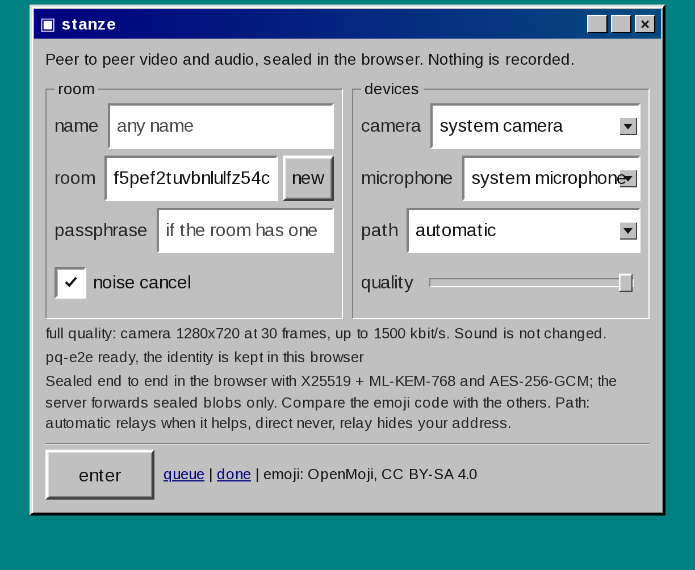
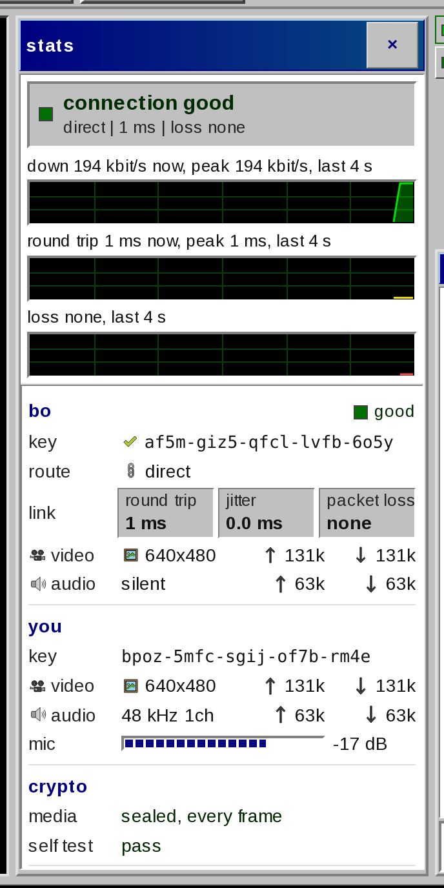
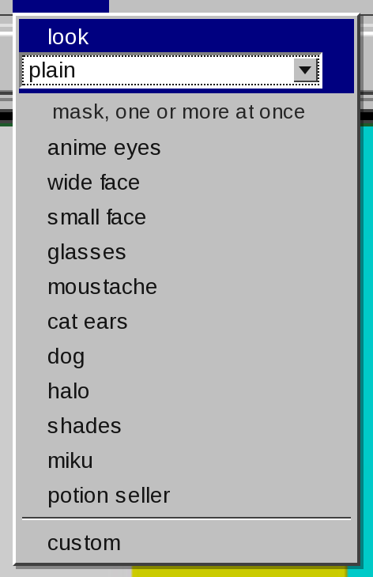

# stanze

Self-hosted group calls that run in the browser. One Go binary serves the client
and the signaling endpoint and carries an embedded TURN relay. Audio and video
travel directly between the browsers in a full mesh, sealed end to end, so the
server never sees, mixes, records or stores them.

No database, no external services and no request to a third party at runtime:
the client font, the emoji set, the sounds and the models all ship inside the
binary.

## Screenshots

The join card, a two person call with both identities pinned, the stats panel
and the effects menu. Fake camera and fake microphone, two browsers on the live
page, so nothing of a real room is in the pictures.




| stats panel | effects menu |
| --- | --- |
|  |  |

## Features

- **One binary.** The browser client is embedded in the executable. A release
  build is self contained apart from the TLS terminator in front of it.
- **Ephemeral rooms.** A room id is 16 random bytes from `crypto/rand` (26
  characters of base32), held in memory only. The first join creates the room,
  the last leave deletes it. No id ever reaches a URL path, a query string or
  the disk.
- **Nothing to enumerate.** There is no route that lists, counts or names a
  room, at any log level. A malformed room id and a full room return the same
  error.
- **Sealed by default.** Names, chat, files and every media frame are encrypted
  in the browser. The server forwards opaque `enc` blobs and has no clear path
  to fall back to.
- **Pinned identities.** Each browser holds a long-term Ed25519 identity and a
  per-origin pin list. A changed key closes the pair until someone confirms a
  device reset.
- **Optional waiting room.** An admin can hold new guests outside until a
  member lets them in; the server enforces who may admit whom.
- **A passphrase that can change.** The value the lobby holds becomes a gate the
  members carry, so an admin can set or change it during the call. The change is
  one sealed commit per pair with a counter; a pair that is already open keeps
  its keys, and a guest with only the old value is refused at the proof.
- **Optional transcription.** Vosk (per-language models) or a single
  multilingual Omnilingual ASR model, both running in the guest's tab. Off
  unless the server is given the model directory.

## Architecture

```
browser A ──────── DTLS/SRTP media (sealed, mesh) ──────── browser B
    │                                                        │
    │  WebSocket: SDP, ICE, opaque enc blobs                 │
    └─────────────────► stanze (Go) ◄────────────────────────┘
                     signaling + TURN/STUN
```

The server is a signaling relay and a relay of last resort: when two peers
cannot connect directly, the embedded TURN server forwards encrypted packets
without the keys. SDP and ICE are relayed verbatim inside one room and never
stored. Mesh topology means upload bandwidth grows with the number of peers,
which is why the default cap is eight.

## Requirements

- Go 1.24 or newer to build.
- Node 22.13 or newer and `npm --prefix client install` once, for the client
  bundle. The bundle is built here, it is not stored in the tree; a tree that
  already carries a fresh `static/app.js` skips the step with
  `SKIP_CLIENT=1 ./build.sh`.
- A modern browser with `RTCRtpScriptTransform` for a sealed room (Chromium,
  Firefox and Safari current at the time of writing).
- A TLS terminator for anything but `http://localhost`, because
  `getUserMedia` requires a secure context.

## Build

```sh
npm --prefix client install   # once, for esbuild
./build.sh                    # client bundle, then bin/stanze and bin/selftest
# or
make build
```

The client source is TypeScript under `client/src`, one module per area; the
file-by-file map is in [client/README.md](client/README.md).
`client/build.mjs` bundles it into `static/app.js` with esbuild, and the build
does that before packing. The bundle is the file the page loads, so a client
change is one build and no server change. The bundle is not in the tree: it is
ignored by version control and every checkout builds it.

The client has nine dev dependencies, one set per job: the bundler, the
checker, the linter with its two rule plugins, and the formatter. Every version
in `client/package.json` is exact, so an install is one version of each package;
`make deps` prints the ones behind the registry and the update is a new exact
version plus `npm --prefix client install`.

The client is packed and embedded as one gzip compressed tar, with sorted names
and no timestamps, so two builds of one commit produce the same archive.

## Run

Loopback, no relay:

```sh
./bin/stanze -listen 127.0.0.1:8095
```

Production shape: relay on a public address, TLS and WebSocket upgrade handled
by the proxy in front.

```sh
TURN_SECRET=$(head -c 32 /dev/urandom | base64) \
TURN_PUBLIC_IP=203.0.113.10 \
./bin/stanze -listen 127.0.0.1:8095 -turn-port 3478
```

Open the page, type a name, press enter. An empty room field creates a new room
and its id lands in the URL fragment (`#r=...`); a pasted id joins that room. A
passphrase typed in the same form is never sent: the page turns it into a SPAKE2
scalar and the guests prove it to each other inside the sealed channel, so a
wrong passphrase costs one failed handshake and the server never sees it.

## Configuration

Every flag has an environment variable of the same name; flags win.

| Flag | Env | Default | Meaning |
| --- | --- | --- | --- |
| `-listen` | `LISTEN` | `:8095` | HTTP listen address, plain HTTP/1.1 |
| `-stun` | `STUN_URLS` | empty | extra STUN URLs for the browsers |
| `-turn` | `TURN` | `on` | run the embedded TURN and STUN server |
| `-turn-public-ip` | `TURN_PUBLIC_IP` | outbound address | address advertised for relay candidates |
| `-turn-port` | `TURN_PORT` | `3478` | UDP port of the embedded relay |
| `-turn-tcp-port` | `TURN_TCP_PORT` | `0` | optional TCP listener for the relay |
| `-turn-secret` | `TURN_SECRET` | random per start | shared secret for ephemeral credentials |
| `-turn-ttl` | `TURN_TTL` | `1h` | lifetime of issued relay credentials |
| `-turn-realm` | `TURN_REALM` | `stanze` | TURN realm |
| `-turn-url` | `TURN_URLS` | empty | extra advertised TURN URL |
| `-turn-min-port` / `-turn-max-port` | `TURN_MIN_PORT` / `TURN_MAX_PORT` | `49200` / `49300` | relay port range to open |
| `-max-peers` | `MAX_PEERS` | `8` | peers per room (2..32) |
| `-max-rooms` | `MAX_ROOMS` | `200` | rooms alive at the same time |
| `-max-msg-bytes` | `MAX_MSG_BYTES` | `262144` | largest accepted WebSocket message |
| `-behind-proxy` | `BEHIND_PROXY` | off | trust `X-Forwarded-For` for per-IP limits |
| `-allowed-origin` | `ALLOWED_ORIGIN` | same host | extra allowed WebSocket `Origin` |
| `-static-dir` | `STATIC_DIR` | empty | serve the client from disk while developing |
| `-vosk-dir` | `VOSK_DIR` | empty | Vosk files and `model-<lang>.tar.gz` models |
| `-omni-dir` | `OMNI_DIR` | empty | sherpa-onnx bundle and the multilingual model |
| `-debug` | `DEBUG` | off | verbose logs, room ids still hashed |

## Deployment

The server speaks plain HTTP/1.1 and expects a TLS terminator:

```nginx
server {
    listen 443 ssl http2;
    server_name stanze.example.com;

    location / {
        proxy_pass http://127.0.0.1:8095;
        proxy_http_version 1.1;
        proxy_set_header Upgrade $http_upgrade;
        proxy_set_header Connection "upgrade";
        proxy_set_header Host $host;
        proxy_set_header X-Forwarded-For $remote_addr;
        proxy_read_timeout 1h;
    }
}
```

Add `-behind-proxy` only when the proxy is the sole way in, otherwise the header
is spoofable and the per-IP limits are meaningless.

Firewall: TCP `8095` from the proxy only, plus UDP `3478` and the relay range
`49200-49300` when TURN is enabled (and the TCP relay port if set). One UDP port
answers both STUN and TURN. Default access logs are already safe: no room id
appears in a path or a query.

## Security model

- **Sealed rooms.** The key exchange runs in the browser in a WebAssembly module
  (`internal/pq`, built to `static/pq.wasm`): X25519 plus ML-KEM-768 per call,
  mixed with HKDF, held in memory, wiped when the peer leaves. Media frames go
  through `RTCRtpScriptTransform` in a worker. A browser that cannot install the
  transform joins without microphone and camera instead of sending clear frames.
- **Names are content.** A peer has no name on the wire; the name arrives as a
  sealed payload after the pair keys exist, and can change at any time.
- **Negotiation is sealed.** The offer, the answer and every candidate travel
  as sealed payloads too, so the server never carries a codec list, a DTLS
  fingerprint or an address. It relays the blob and refuses a clear description
  with `sealed-only`, which only a page from before this change can send.
- **Fixed sizes.** Every sealed payload is padded to 512, 2048 or 8192 bytes, or
  a whole multiple of 8192, before it is sealed, so the frame size does not say
  whether a chat line or a file offer went by.
- **Short code.** Both sides show the same 13-character code and six emoji per
  tile, for comparison over the call, next to a fingerprint badge that reads
  `verified N of M`.
- **Files.** A file offer travels as a sealed payload; the bytes go over one
  sealed data channel per pair. Nothing is written until the receiver clicks
  save.
- **Logs.** Info level holds listen addresses and counts. A join writes no room
  id, no room fingerprint and no head count: the debug line says that a socket
  joined and nothing about which room or how large it is.

Changing the post-quantum module requires rebuilding the Wasm file with `make
wasm`, which runs:

```sh
GOOS=js GOARCH=wasm go build -trimpath -ldflags "-s -w" -o static/pq.wasm ./cmd/pqwasm
```

`static/pq.wasm` is a build artifact and is not in git, like `static/app.js`.

## Signaling protocol

One JSON object per WebSocket text frame. Client to server:

| Message | Fields |
| --- | --- |
| `join` | `room` (the passphrase is never on the wire; a `pass` field from an old client is ignored) |
| `enc` | `to` (empty or `*` for the room), `b` (sealed description, candidate, name, chat, file or toggle state) |
| `state` | – (an old client's clear toggles; accepted and dropped, never echoed) |
| `mod` | `to`, `action` (`kick`, `mute`, `admin`) or `waitingroom` with `on` |
| `admit` | `to` |
| `leave`, `ping` | – |

Server to client:

| Message | Fields |
| --- | --- |
| `joined` | `self`, `peers[]`, `admins`, `waitingRoom`, `waiting`, `ice[]` |
| `peer-joined`, `peer-left` | `peer`, `from` |
| `enc` | `from`, `b` (forwarded verbatim) |
| `admin`, `mod`, `kicked` | as above (the toggles travel sealed, one copy per pair) |
| `waiting-room`, `admitted` | `waitingRoom` / `from`, `peer` |
| `error`, `pong` | `code` / – |

The guest receives one item in `ice[]` per connection: a fresh, time-limited
TURN credential in the TURN REST form (`timestamp:tag` username, HMAC-SHA1 with
the shared secret). Nothing else is handed out.

## Testing

`cmd/selftest` is an end-to-end suite against a running server with real
`pion/webrtc` peers, so it proves the relay and the media path, not just JSON.

```sh
./bin/stanze -listen 127.0.0.1:8095 -turn-public-ip 127.0.0.1 -turn-secret test &
./bin/selftest -addr http://127.0.0.1:8095
```

It covers: the embedded client is served, every plausible room-listing path is
a 404, a room id never appears in a response, a malformed id and a full room
produce byte-identical errors, an old `pass` field is ignored, a clear
description is refused and
never relayed while the same description inside `enc` arrives intact,
`peer-left` arrives, a freed id is a new room, the room cap holds, cross-room
relaying is dropped, oversized messages close the connection, and two peers
connect directly and through the embedded relay with the issued credentials.

Browser suites in `tools/` (each needs a server and a `playwright-core`):

| Script | What it proves |
| --- | --- |
| `smoke.js` | a fresh page joins, chats, toggles devices; fails on the first uncaught error |
| `browser-e2e.js` | two users, one room: tiles, media frames, mute, volume, stats, reconnect |
| `pq-browser-e2e.js` | sealed handshake, matching codes, sealed chat, replay refused |
| `pq-mesh-e2e.js` | third guest, unsigned peer, unpinned key, stripped identity are refused |
| `pq-file-e2e.js` | file offers, chunked transfer, cancel, refuse, SHA-256 match |
| `join-race-e2e.js` | a lost handshake step is retried instead of never completing |

```sh
PW=/tmp/pw/node_modules/playwright-core ROOMSBASE=http://127.0.0.1:8095 \
  node tools/browser-e2e.js
```

`make` targets: `build`, `client`, `selftest`, `run`, `test` (selftest against
`ADDR`), `typecheck` (the TypeScript client), `lint`, `format`, `deps` (client
dependencies behind the registry), `smoke`, `sealed`, `check` (typecheck, lint,
then smoke). `tools/wsjoin.py` is a dependency-free WebSocket client
for a one-shot join. With gcc present, `go test -race ./...` also runs.

## Repository layout

```
main.go, hub.go, peer.go    HTTP surface, room registry, peer sockets
signaling.go                message handling and per-IP limits
ice.go                      embedded TURN/STUN and credential issuing
config.go                   flags and their environment variables
internal/pq                 post-quantum handshake, built to static/pq.wasm
cmd/selftest                end-to-end suite against a live server
cmd/pack                    client packer (embedded archive)
static/                     browser client: app.js, workers, styles
tools/                      browser suites and helper scripts
deploy/                     deployment manifest
```

## Limits

- Mesh topology, no SFU: upload cost grows with the number of peers.
- No server-side recording, mixing, moderation or history.
- No TLS in the binary; terminate it in the proxy.
- Transcription is a client feature and needs the model files on disk.
